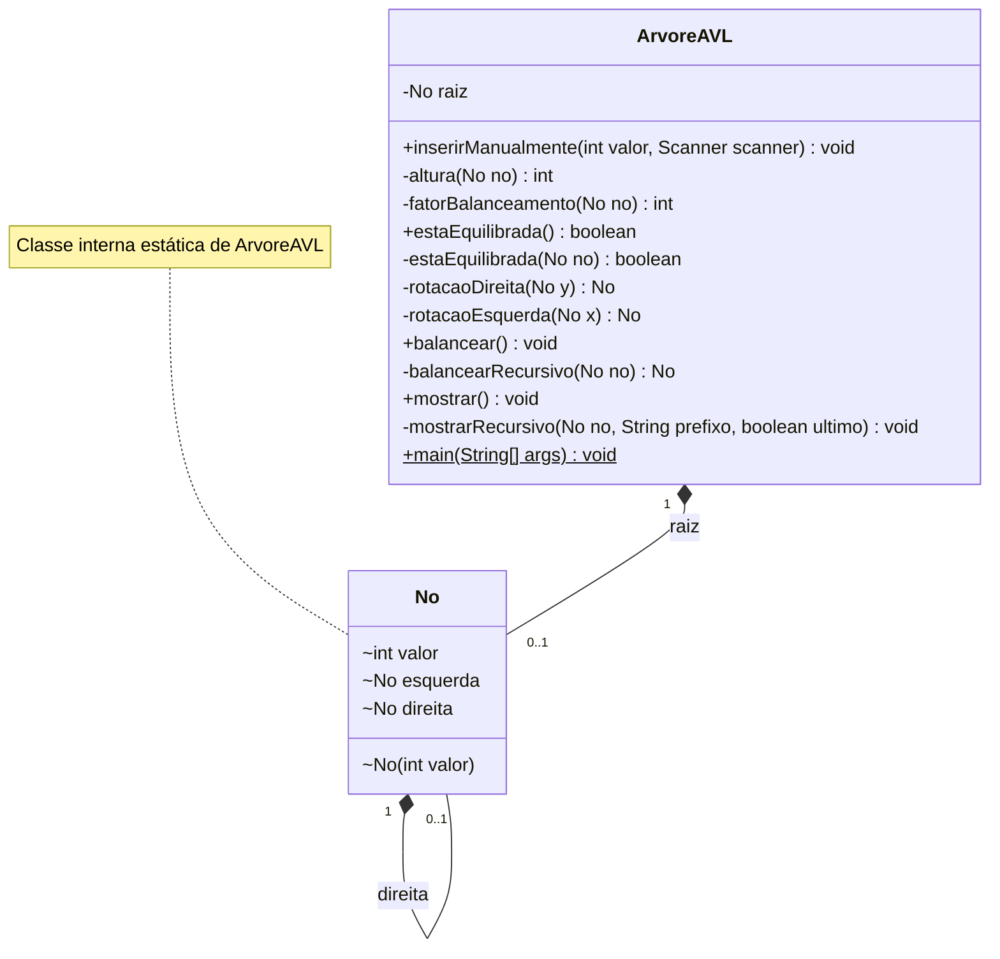

# Balanceamento AVL

Programa Java de terminal para construir uma árvore binária manualmente, verificar seu equilíbrio e aplicar rotações LL, RR, LR e RL, mostrando a árvore antes e depois.

## Diagrama de classes

O diagrama representa as classes e os membros definidos em `src/ArvoreAVL.java`. `No` é uma classe interna estática de `ArvoreAVL`; seus atributos e seu construtor têm acesso de pacote.

- **ArvoreAVL** mantém a raiz, oferece a navegação para inserção manual, calcula alturas e fatores de balanceamento, aplica rotações e exibe a árvore. O método estático `main` executa o menu e usa `java.util.Scanner` para ler os dados.
- **No** armazena um valor inteiro e as referências aos filhos esquerdo e direito. A raiz e cada filho podem estar ausentes, representados pela multiplicidade `0..1`.
- **Visibilidade:** `+` indica acesso público, `-` privado e `~` acesso de pacote. O símbolo `$` indica método estático.

A inserção manual permite escolher a posição dos valores sem validar a regra de árvore binária de busca. A verificação de equilíbrio considera as alturas das subárvores; as rotações preservam a ordem em percurso em ordem, mas não corrigem valores posicionados fora da regra de busca.
